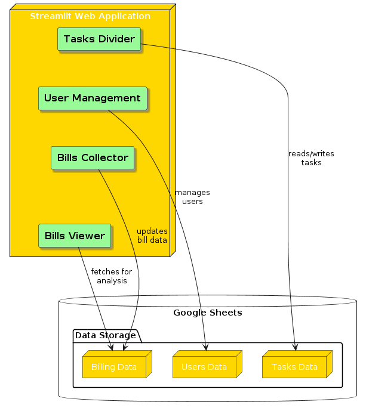

# Al Rajhi Takaful — Collections Dashboard

<div dir="rtl">

لوحة تحكم لفريق تحصيل أقساط التأمين: توزيع ملفات المهام على الموظفين، تسجيل نتيجة كل اتصال وتحصيل، وتحليل الأداء بالرسوم البيانية — مبنية بـ Streamlit وتستخدم Google Sheets كقاعدة بيانات.

</div>

An admin dashboard for an insurance collections team. Supervisors split an Excel list of policies between agents, agents log the result of every call, and the dashboard turns the results into charts per agent, side-by-side comparisons and team totals. Data lives in Google Sheets, so no database server is needed.




## Pages

| Page | What it does |
|---|---|
| **Bills Collector** | An agent picks their name, gets their next policy pre-filled, records the call result (paid, pay later, no answer, …), amounts and notes. The row moves from the agent's sheet to the shared `Done` sheet. |
| **Bills Viewer** | Charts for a date range: result share, result counts and money per result — for one agent, a comparison between agents, or the whole team. |
| **Tasks Divider** | Upload an Excel file of policies and split it between agents, either evenly or with a set number per agent. Each agent gets their own worksheet. |
| **User Management** | Add or remove agents. |

## Getting started

```bash
pip install -r requirements.txt
cp .streamlit/secrets.toml.example .streamlit/secrets.toml   # then fill in your service account
streamlit run Home.py
```

### Google Sheet setup

1. Create a Google Cloud service account, download its JSON key and copy the values into `.streamlit/secrets.toml`.
2. Create a spreadsheet, share it with the service account's email (Editor), and put its URL in `spreadsheet`.
3. Add these worksheets:
   - `Users` with the columns `Username`, `Password`
   - `Done` with the columns `Username`, `PolicyNumber`, `Mobile`, `Money`, `CollectedMoney`, `Rest`, `NumCalls`, `Result`, `Date`, `AdditionalNotes`
   - one worksheet per agent, named exactly like the username (the Tasks Divider fills them)

`sample_tasks.xlsx` is a small file with made-up policies to try the Tasks Divider.

## Project structure

```
Home.py                  Landing page
pages/                   Bills Collector, Bills Viewer, Tasks Divider, User Management
docs/diagrams/           Architecture and sequence diagrams
sample_tasks.xlsx        Demo input with fake data
.streamlit/              secrets.toml.example (the real secrets.toml is git-ignored)
```

## Author

**Renad Madi** — [GitHub](https://github.com/RENAD-MADI)
